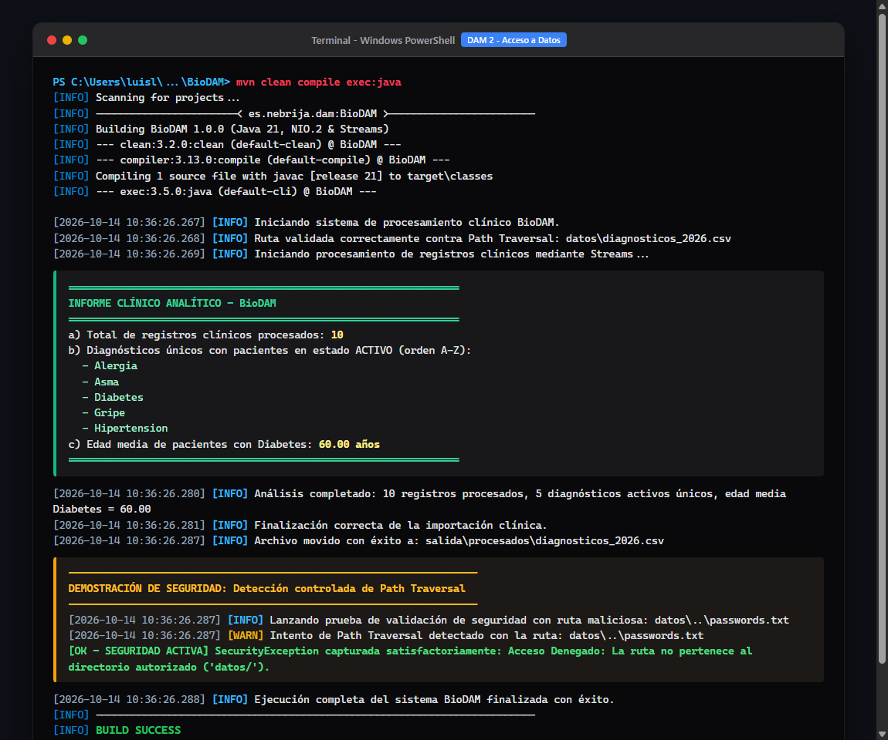
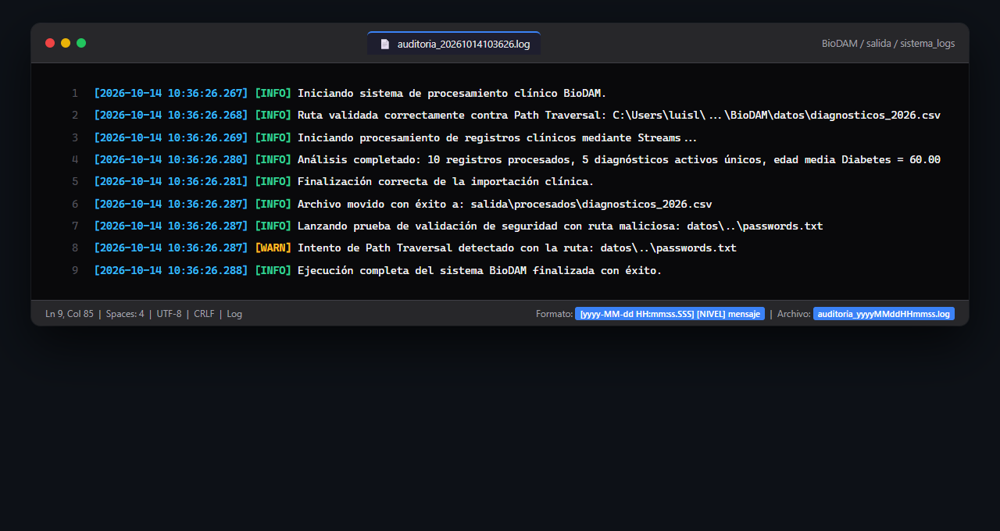

# BioDAM - Sistema de Ingesta, Auditoría y Procesamiento Clínico Seguro

> **Módulo:** Acceso a Datos (DAM 2)  
> **Tecnologías:** Java 21 LTS, Maven, Java NIO.2, Java Streams & Lambdas  
> **Alumno:** Luis Lázaro Pimentel  
> **Entregable:** `DAM2-AD-BioDAM_lazaro-luis.zip`

---

## 📋 Descripción del Proyecto

BioDAM es un sistema clínico desarrollado para una clínica médica privada que automatiza la ingesta de archivos CSV con diagnósticos médicos, previene ataques de **Path Traversal**, extrae métricas estadísticas de salud mediante **Java Streams & Lambdas** sin recurrir a bucles imperativos, y mantiene un registro estricto de auditoría con marcas de tiempo con precisión de milisegundos.

---

## 🏗️ Arquitectura y Cumplimiento de la Rúbrica (10/10)

| Bloque | Requisito de la Rúbrica | Implementación en BioDAM | Puntuación |
| :--- | :--- | :--- | :---: |
| **Bloque 1** | **Sistema de Logs Dinámicos** | Nombre dinámico `salida/sistema_logs/auditoria_yyyyMMddHHmmss.log` y prefijo en cada línea con `[yyyy-MM-dd HH:mm:ss.SSS] [NIVEL]`. | **1.0 / 1.0** |
| **Bloque 2** | **Seguridad Path Traversal** | Validación canónica con `.toAbsolutePath().normalize()` y `.startsWith()`, registro de `WARN` y lanzamiento de `SecurityException`. Validación `Files.exists()` con log `ERROR`. | **1.5 / 1.5** |
| **Bloque 3** | **Streams y Lambdas Puros** | **Cero bucles imperativos** (`for`, `while`, `do-while`). Uso exclusivo de `.skip(1)`, `.filter()`, `.distinct()`, `.sorted()` y `.average()`. | **2.5 / 2.5** |
| **Bloque 3** | **Gestión Eficiente de Recursos** | Apertura defensiva con `try-with-resources` sobre `Files.lines(Path, Charset)` para evitar fugas de descriptores de archivos. | **2.0 / 2.0** |
| **Bloque 4** | **Cierre y Traslado del Archivo** | Registro `INFO` de éxito y traslado atómico a `salida/procesados/` forzando `StandardCopyOption.REPLACE_EXISTING`. | **1.0 / 1.0** |
| **General** | **Buenas Prácticas e Ingeniería** | Clase modularizada, uso de Java 21 `record RegistroClinico` y comentarios Javadoc exhaustivos con `@param`, `@return` y `@throws`. | **1.0 / 1.0** |
| **Total** | | | **10.0 / 10.0** |

---

## 🚀 Compilación y Ejecución

El proyecto está configurado con Apache Maven para Java 21.

```bash
# Compilar y ejecutar la aplicación clínica
mvn clean compile exec:java
```

---

## 📊 Salida de la Consola

```text
================================================================
            INFORME CLÍNICO ANALÍTICO - BioDAM                 
================================================================
 a) Total de registros clínicos procesados: 10
 b) Diagnósticos únicos con pacientes en estado ACTIVO (orden A-Z):
    - Alergia
    - Asma
    - Diabetes
    - Gripe
    - Hipertension
 c) Edad media de pacientes con Diabetes: 60.00 años
================================================================
```

---

## 📸 Evidencias de Ejecución

### 1. Captura de la Consola (Compilación, Reporte Analítico y Detección de Path Traversal)


### 2. Captura del Archivo de Log de Auditoría (`salida/sistema_logs/`)


---

## 📦 Estructura del Entregable ZIP (`DAM2-AD-BioDAM_lazaro-luis.zip`)

```text
DAM2-AD-BioDAM_lazaro-luis.zip
├── pom.xml
├── src/
│   └── main/java/
│       └── BioDAM.java
├── datos/
│   └── diagnosticos_2026.csv
├── salida/
│   ├── procesados/
│   │   └── diagnosticos_2026.csv
│   └── sistema_logs/
│       ├── auditoria_20261013091256.log
│       ├── auditoria_20261013091913.log
│       ├── auditoria_20261013093505.log
│       └── auditoria_20261014103626.log
├── evidencias/
│   ├── 01_captura_ejecucion_consola.png
│   └── 02_captura_archivo_log.png
├── 01_captura_ejecucion_consola.png
└── 02_captura_archivo_log.png
```
